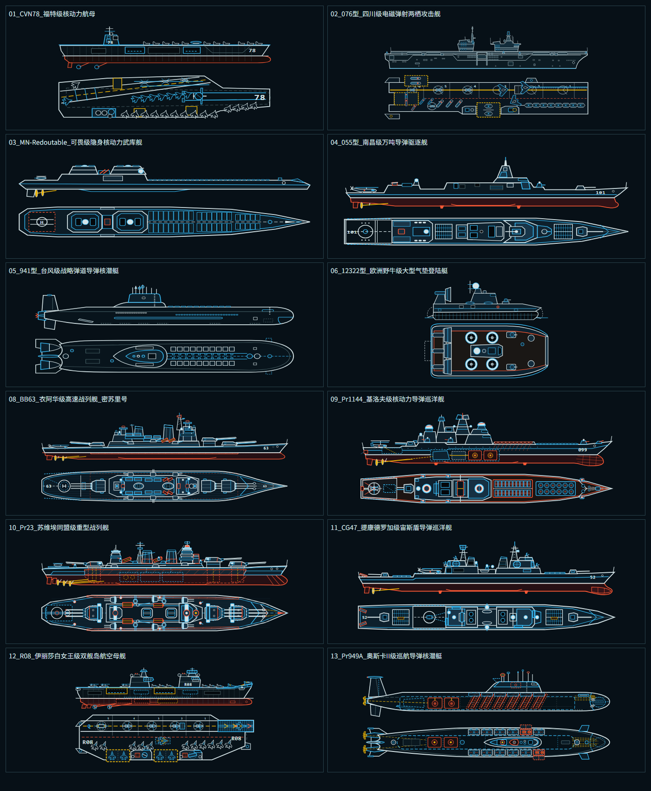
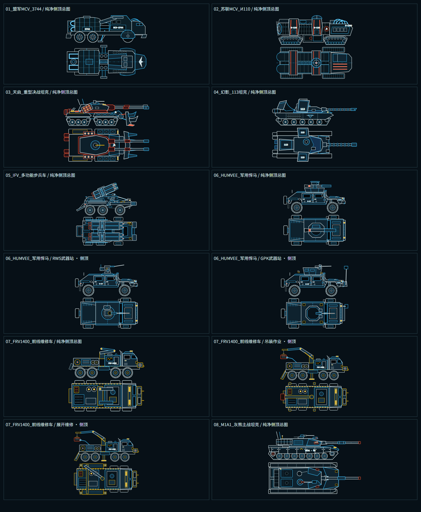
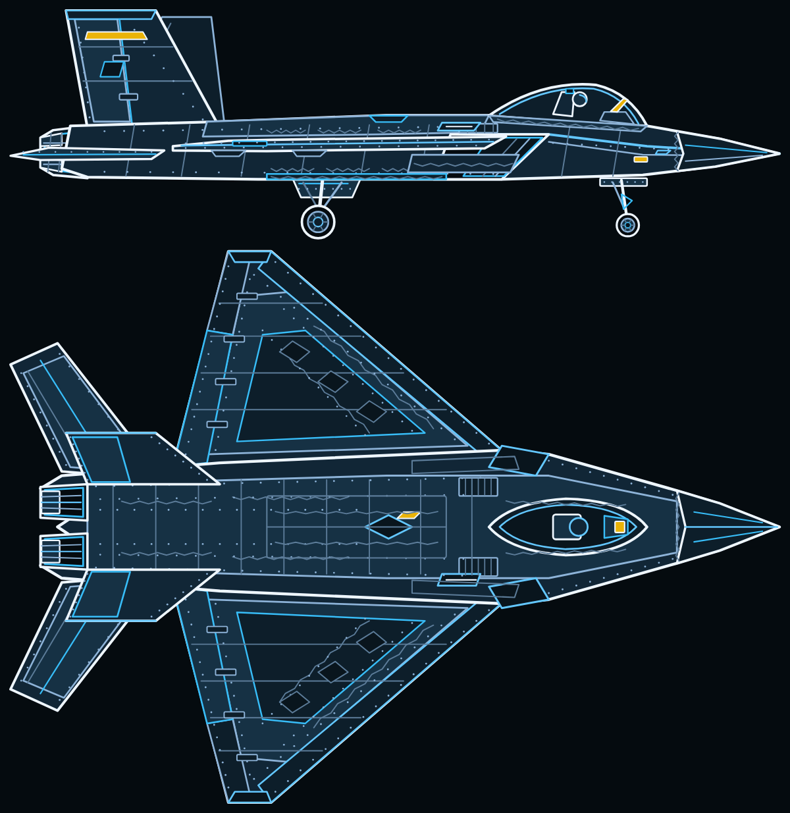

# Tactical SVG Arsenal · 三军工程蓝图矢量资产库

一套面向战术界面、世界观设定集与前端可视化项目的 **海陆空三军正交工程蓝图 SVG 矢量资产库**，内置基于 **Vue 3 + TypeScript + Vite** 的交互式光桌检视工作台（Lightbox Inspector）与结构化元数据索引。

- 🌐 **在线光桌预览 (GitHub Pages)**：<https://thomas-flores123456.github.io/tactical-svg-arsenal/>
- 📦 **在线结构化总索引 (`catalog.json`)**：<https://thomas-flores123456.github.io/tactical-svg-arsenal/metadata/catalog.json>
- 🖼️ **按稳定 ID 直连单张 SVG 示例**：<https://thomas-flores123456.github.io/tactical-svg-arsenal/assets/air.allied.f22a_raptor.default.clean.master.svg>

---

## 一、 资产规模与分库总览

当前版本共收录 **146 个装备组、319 份独立自包含的 `.svg` 矢量图纸**（纯矢量总体积仅 ~15 MB，零外部图片/字体依赖，严格禁用 `<script>` / `<foreignObject>` / `<image>` 等非安全标签）：

| 军种分库 | 源目录 | 装备组数 | SVG 图纸数 | 涵盖类别与构型特色 |
| :--- | :--- | ---: | ---: | :--- |
| **海军 (Navy)** | [`assets/navy/`](assets/navy/) | **37 组** | **156 份** | 核航母、两栖攻击舰、战列舰、核巡洋舰、驱护舰、战略/攻击核潜艇、特种潜航器及舰载航空兵联队（含单视拆件图、双联工程总图与 36 份纯净侧顶总图） |
| **陆军 (Army)** | [`assets/army/`](assets/army/) | **67 组** | **96 份** | 机动基地车 (MCV)、主战/重型/特种坦克、步兵战车、自行火炮、远程火箭炮、弹炮防空系统与特种工程车（支持行军态 / 攻城展开态 / 吊装态等多构型切换） |
| **空军 (Air Force)** | [`assets/air/`](assets/air/) | **42 组** | **67 份** | 隐身制空战斗机、前掠翼突击机、超音速/飞翼战略轰炸机、倾转旋翼/涵道机、共轴武直、战略运输/预警机与空中武库母舰（支持闭舱巡航 / 弹舱开启 / 垂直悬停等多构型切换） |
| **合计** | `assets/*` | **146 组** | **319 份** | 全部资产均具备全局唯一稳定标识 `data-asset-id` 与 SHA-256 完整性校验 |

### 预览集锦 (Showcase)

| 海军纯净侧顶总图联系表 | 陆军重装地面合成群联系表 | 空军隐身制空战斗机双视图 |
| :---: | :---: | :---: |
|  |  |  |

---

## 二、 仓库目录结构

```text
.
├── assets/                        # 【唯一真实源】三军 SVG 矢量源文件库
│   ├── navy/                      # 海军舰艇与舰载机群 (01 ~ 37)
│   ├── army/                      # 陆军地面战斗与支援车辆 (01 ~ 55)
│   └── air/                       # 空军战机与特种飞行器 (01 ~ 18)
├── metadata/                      # 【结构化元数据】供外部项目或前端直接读取的 JSON 索引
│   ├── catalog.json               # 自动生成的全量装备组与图纸索引（含 ID、尺寸、SHA-256、视角与构型）
│   ├── classification.json        # 军种、装备大类、子类与考证说明词典
│   ├── source-baseline.json       # 原始海军 119 份蓝图 SHA-256 防篡改基线
│   └── titan-import.json          # 陆军先导批次几何提取与哈希审计凭证
├── src/                           # 【光桌工作台】Vue 3 + Pinia + TS 前端源码
│   ├── components/                # AssetInspector（模态光桌：无级缩放平移、图层显隐、源码复制）、EquipmentCard
│   ├── composables/               # usePanZoom 视口相机数学
│   ├── lib/ & stores/             # 稳定分类排序、多维组合筛选与本地收藏状态
│   └── views/                     # CatalogView 资产画廊主视图
├── scripts/                       # 【构建与校验管线】
│   ├── build-index.mjs            # 扫描 assets/ -> 生成 metadata/catalog.json 并同步至 public/assets/<id>.svg
│   └── verify-clean-fleet.py      # XML 安全契约与无头 Chromium getBBox() 几何包络自动验证脚本
├── tests/                         # 【自动化测试】Node.js 内置测试套件（18 项契约与回归测试）
└── docs/                          # 【工程规范文档】
    ├── SOP-cad-blueprint.md       # 1:1 长宽比工程蓝图生产与双图层解耦标准作业程序 (SOP)
    ├── navy-catalog.md            # 海军舰艇详细参数与 Asset ID 速查表
    └── showcase/                  # 代表性预览图
```

---

## 三、 快速启动（本地光桌浏览器）

环境要求：**Node.js >= 22**。

```bash
# 1. 安装依赖
npm ci

# 2. 启动本地光桌工作台（自动执行 predev 索引同步并监听 http://127.0.0.1:5178/）
npm run dev
```

### 常用工程命令

```bash
npm run index            # 扫描 assets/{navy,army,air}，更新 metadata/catalog.json 并复制扁平化资产至 public/assets/
npm run verify           # 校验源文件、基线、catalog.json 与 public/assets/ 副本的 SHA-256 严格一致
npm test                 # 运行全套 Node.js 自动化测试（唯一ID、分类覆盖、双视图图层结构、视口相机数学）
npm run build            # 索引同步 + TypeScript 类型检查 + 生成可部署至 GitHub Pages 的 dist/ 静态站点
npm run verify:geometry  # (需 Python 3 + Chrome) 运行无头浏览器 getBBox() 校验全量 142 张纯净图几何包络
```

---

## 四、 如何在外部项目（或我们自己的前端/角色卡）中复用？

本仓库同时支持 **人工按文件夹直观查找** 与 **代码按稳定英文 ID 确定性引用**：

### 1. 通过稳定 `data-asset-id` 直接引用扁平化 SVG
运行 `npm run index` 或 `npm run build` 后，所有 262 份 SVG 会以 `<data-asset-id>.svg` 的纯英文稳定文件名输出到 `public/assets/`（构建后位于 `dist/assets/`）：

- F-22A 猛禽（闭舱巡航态）：`assets/air.allied.f22a_raptor.default.clean.master.svg`
- F-22A 猛禽（弹舱全开态）：`assets/air.allied.f22a_raptor.weapons_open.clean.variant.svg`
- 055 型万吨大驱（纯净侧顶总图）：`assets/naval.type055.clean.master.svg`
- 天启重型决战坦克（纯净侧顶总图）：`assets/army.soviet.apocalypse.default.clean.master.svg`

如果将仓库构建产物发布到 **GitHub Pages** 或通过 CDN 托管，任何前端或卡片只需拼接 `https://<your-pages-domain>/assets/<data-asset-id>.svg` 即可稳定加载，不受源文件夹中文名或序号调整影响。

### 2. 通过 `metadata/catalog.json` 编程式检索与驱动多状态切换
外部项目可直接导入 [`metadata/catalog.json`](metadata/catalog.json)，其中包含：
- `equipment[]`：110 个装备组，含 `id`、`name`、`service` (`navy` / `army` / `air`)、`platform` (`sea` / `land` / `air`)、`faction` (`allied` / `soviet` / `yuri` / `common`)、`categoryId`、`subtypeId`、`coverId` 及所属图纸 `views[]`。
- `assets[]`：262 份图纸元数据，含 `id`、`sourcePath`、`url`、`width`、`height`、`sha256`、`kind` (`clean-master` / `clean-variant` / `master` / `single`)、`label` 与 `configuration`（构型标识，如 `default` / `weapons_open` / `hover` / `deployed`）。

### 3. SVG 内部图层契约（支持局部提取与动态换肤）
- **纯净侧顶总图 (`clean-master` / `clean-variant`)**：顶层严格包含 `<g id="clean-side">`（正交侧视图）与 `<g id="clean-top">`（正交顶视图），无背景矩形，可直接嵌入任意深色/浅色 UI 容器或单独提取单一视角。
- **工程蓝图 (`master` / `single`)**：顶层包含 `<g id="layer-backdrop">`（深空网格与参数铭牌图框）与核心几何层，光桌与外部宿主可通过移除或隐藏 `#layer-backdrop` 一键切换纯净舰体视图。

---

## 五、 开源协议 (License)

本项目采用 [MIT License](LICENSE) 开源。
